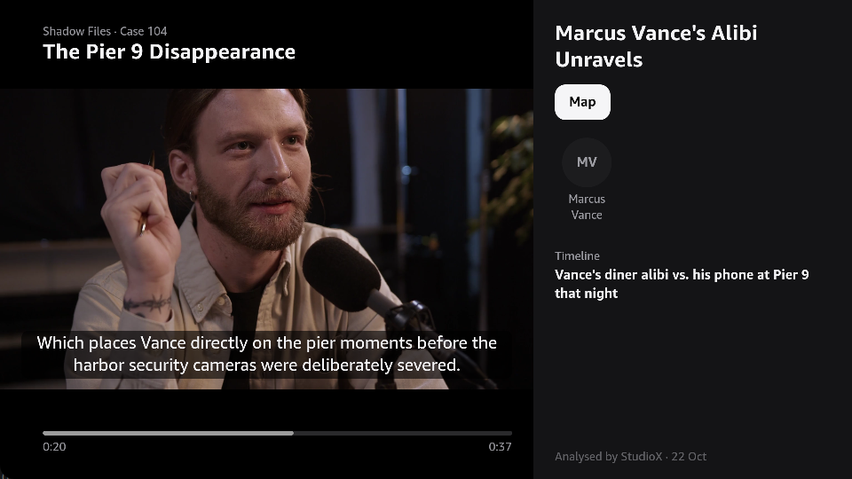
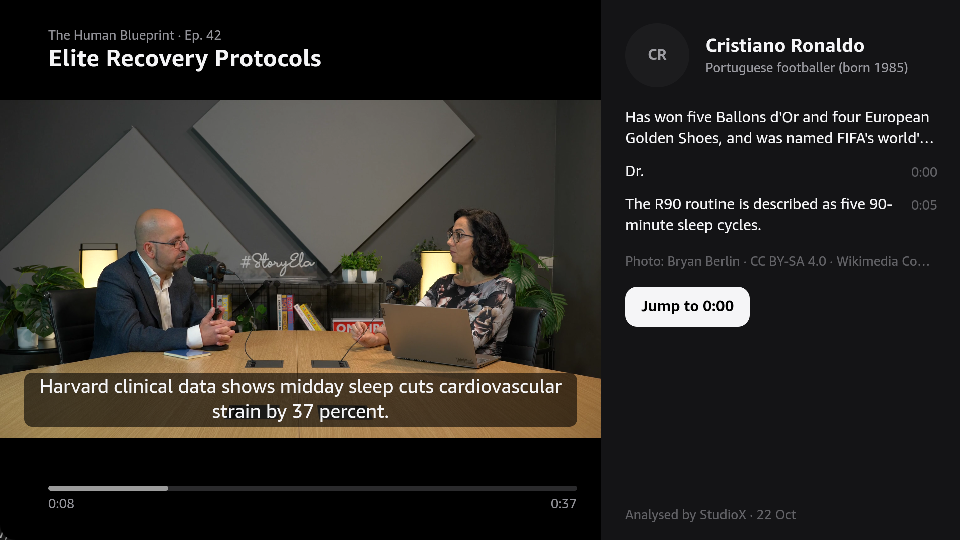
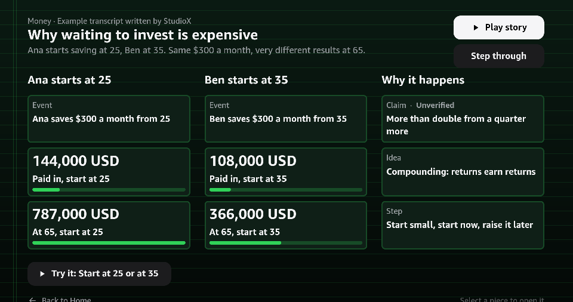
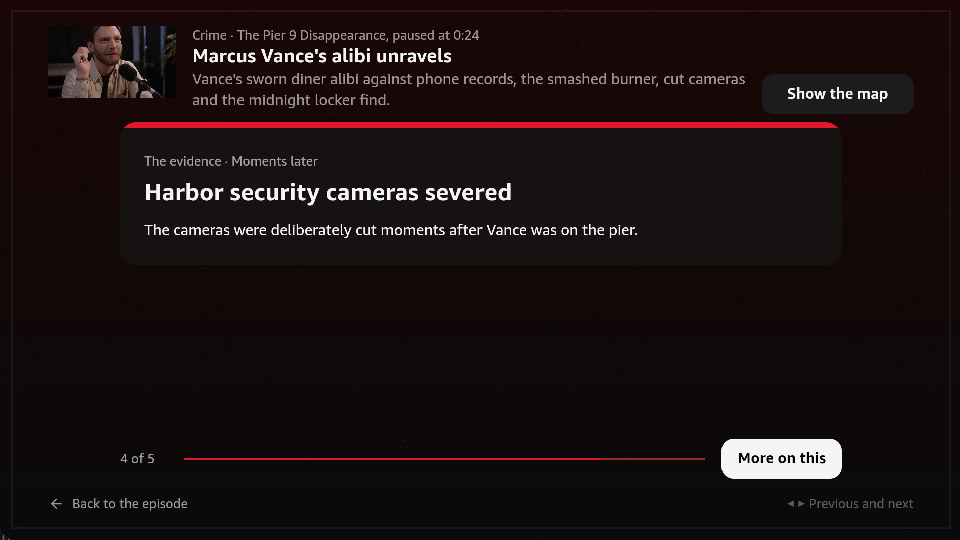
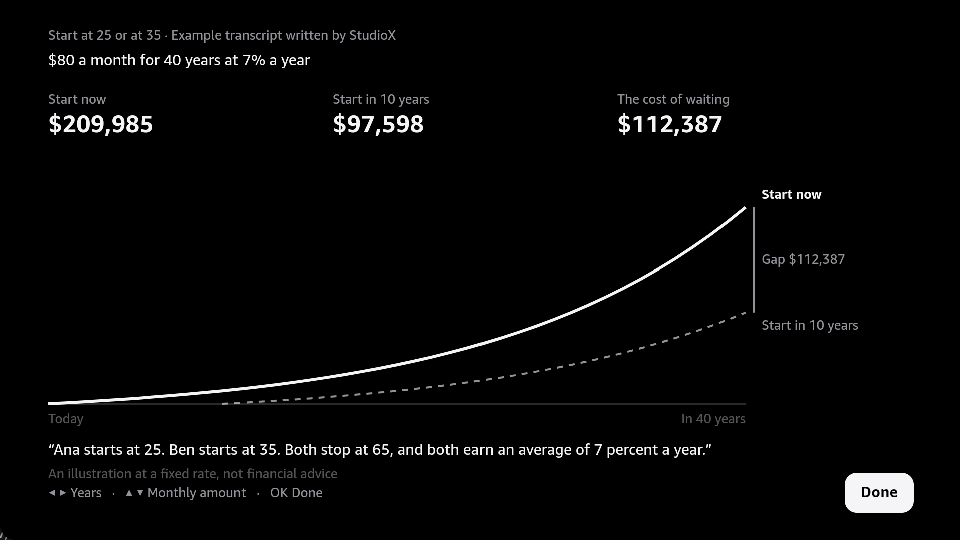
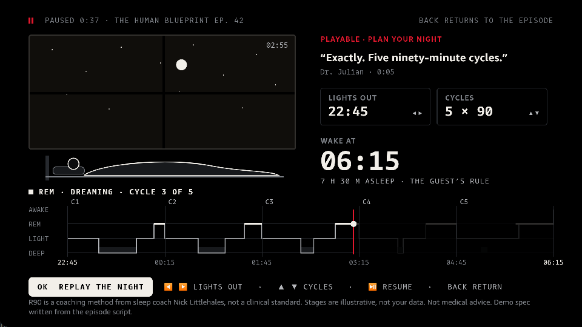
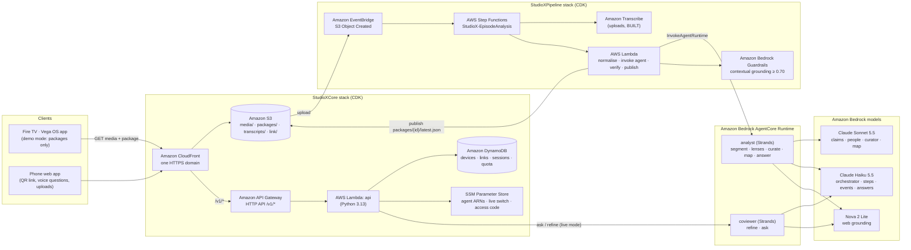
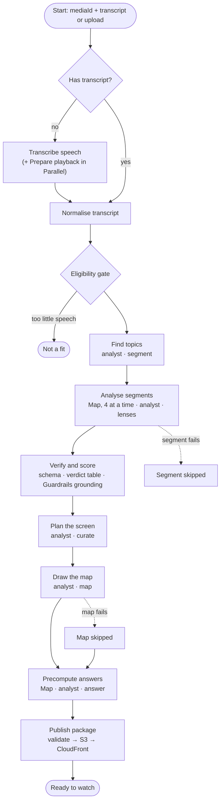

# StudioX: see the whole story

[](https://github.com/Shantanu-00/StudioX/actions/workflows/ci.yml) [](LICENSE)  

**An AI video player for Fire TV: press Map and a whole episode becomes one picture you can play.
Built natively for Vega OS and powered by Strands agents on Amazon Bedrock AgentCore.**

We watch long videos in pieces: a podcast tonight, the rest tomorrow. Every idea makes sense, but
when we come back, a piece is gone, and we can't see how it all fits together. Rewinding won't fix
that, and a phone pulls us out of the show. StudioX puts the fix on the screen we're already
watching. Press **Map** and the whole episode becomes one picture you can play. Press **Pause** and
you see who they're talking about and which claims hold up, with sources. Nothing past your
playhead is ever shown.

> **Build, Ship, Shape: Amazon Developer Hackathon** · **Fire TV track (Vega OS)** · **AWS Builder
> Mini Challenge** · **Friction log: 48 entries + 14 feature requests**



## For judges: the two-minute tour

| You want to check | Go to |
| --- | --- |
| **Friction log (bonus)**: 48 entries + 14 feature requests. Each has task, steps, expected vs. actual, severity, workaround and suggestion | **[FRICTION_LOG.md](FRICTION_LOG.md)** |
| **AWS Builder Mini Challenge**: architecture, every service, the Strands and AgentCore primitives, the commands to run it | **[AWS section below](#aws-builder-mini-challenge)** · [docs/aws-builder.md](docs/aws-builder.md) |
| **What the demo shows**, and the technology behind each moment | [The demo, moment by moment](#the-demo-moment-by-moment) |
| **Vega OS** features used, with file paths | [Built on Vega OS](#built-on-vega-os) |
| How to run and test it. **No login or keys needed**: the demo build streams from public CloudFront, and the paid AI routes are gated | **[TESTING.md](TESTING.md)** |
| How the project maps to each judging criterion | [Judging criteria](#how-studiox-maps-to-the-judging-criteria) |
| The agent → TV contract | [backend/CONTRACTS.md](backend/CONTRACTS.md), [docs/ARCHITECTURE.md](docs/ARCHITECTURE.md) |
| Demo video | Linked on the Devpost project page |

## The demo, moment by moment

| Moment | What you see | Technology behind it |
| --- | --- | --- |
| **The Map** (sleep episode) | Press **Map**: the whole episode as one picture (the sleep cycles, the supplements, the cool room). OK on any piece jumps to its moment in the video | Map authored by the `analyst` agent's `map` mode (Strands, Claude Sonnet 5.5), validated in code, drawn natively with Reanimated + SVG |
| **Play the night** | **Play** animates the night the guest describes: the moon crosses, deep → light → REM → dawn. ◀ ▶ moves lights-out and the wake time snaps to whole 90-minute cycles | `night` simulation, parameters clamped in code. Reanimated worklets on the UI thread |
| **Same button, different genre** (crime episode) | The crime theme: the alibi, the phone ping, the conflict marked. **Only what you've watched so far.** Later nodes stay locked to the playhead | Vega W3C media player (MSE + `KeplerVideoSurfaceView`), Vega Media Controls. SpoilerGuard in the agents |
| **Test a theory from the phone** | Ask by voice in the phone web app: "Doesn't the ping break his alibi?" The TV answers: "It shows where the phone was, not who was holding it." | Phone web app (Web Speech API) → CloudFront → API Gateway → Lambda (Guardrails prompt-attack screen) → AgentCore `coviewer` agent in live mode. In demo mode the same question has a precomputed answer in the package |
| **The surprise: size** | Each map is **under 25 KB** of data (14.7–23.4 KB). The whole app is **under 1 MB** (947 KB release `.vpkg`) | Vega OS ships React Native, Hermes, Reanimated, SVG and w3cmedia in the OS, pre-warmed. That runtime is over 10 MB ([Amazon](https://developer.amazon.com/docs/vega/0.24/vega-rn-arch.html)) |
| **Breadth** | Three more maps, each animating in: *Start at 25 or at 35?* (finance), *Apollo 11: the landing day* (history), *From your remote to the server and back* (tech) | The same pipeline and the same native renderer. Layouts: compare, timeline, flow, cluster |
| **Who they're talking about** | A who's-who card for the person the narrator describes, not just who's speaking. Public figures get a licensed portrait with its credit | `people` lens + Wikipedia + Commons licence filter (CC0 / PD / CC BY / CC BY-SA) |
| **Fact checks that stay quiet** | A claim that holds up shows no badge. One that is incomplete says so, with the source: *"Partly. The 37% was about heart-disease deaths."* | `claims` lens + Nova 2 Lite web grounding + a deterministic verdict table. CitationGuard keeps only sources a search really returned |
| **Processed once, not per view** | Step Functions runs the agents once per video. The package goes to CloudFront and reaches every TV | [AWS section](#aws-builder-mini-challenge) |

| | |
| --- | --- |
|  |  |
|  |  |
|  | All screenshots are from the Vega Virtual Device (SDK 0.24.12112). The demo episodes are short clips we produced (stock footage, scripted dialogue) |

## How StudioX maps to the judging criteria

| Criterion (25% each) | What StudioX does | Evidence |
| --- | --- | --- |
| **Technical implementation** | Native Vega app: W3C MSE in React Native, `KeplerVideoSurfaceView`, Vega Media Controls, the Vega SeekBar, component lifecycle, system toast. On AWS: a CDK-defined Step Functions pipeline of Strands agents on AgentCore Runtime, with Guardrails grounding and rule-based verdicts. 203 Jest tests and 137 Python tests. Evals: 0 false DEBUNKED, 0 spoiler leaks | [Built on Vega](#built-on-vega-os), [AWS](#aws-builder-mini-challenge), [`test/`](test), [`backend/eval/results.md`](backend/eval/results.md) |
| **Design** | A 10-foot UI on Vega's 960 × 540 dp canvas. Every element is D-pad reachable, with a visible focus ring, deterministic first focus, focus restored on return, and a full BACK chain. Each genre gets its own Map theme, and animation starts only when the user asks | [docs/product/design-language.md](docs/product/design-language.md), [docs/product/tv-ui-guidelines.md](docs/product/tv-ui-guidelines.md), [`src/components/FocusFrame.tsx`](src/components/FocusFrame.tsx), [`src/map/themes.ts`](src/map/themes.ts) |
| **Potential impact** | Long videos are now TV: viewers watched over 400M hours of podcasts a month on living-room devices in 2024 ([YouTube, Feb 2025](https://blog.youtube/news-and-events/1-billion-monthly-podcast-users/)). And they watch in pieces: Prime Video's VP of Product calls forgetting where you left off "a common problem customers face when streaming content" ([Amazon, X-Ray Recaps](https://www.aboutamazon.com/news/entertainment/amazon-prime-video-x-ray-recaps)). StudioX takes that idea to any long video, as a picture instead of a summary. Each video is processed once, not per view, into a package under 25 KB, so the cost is per episode and any Vega content app could use the same package and renderer | [The demo, moment by moment](#the-demo-moment-by-moment), [AWS section](#aws-builder-mini-challenge) |
| **Quality of the idea** | Not a video player with a chatbot. X-Ray showed TV can tell you more; StudioX makes it generative. It turns each episode into a playable map, adapts to the genre, is spoiler-safe by design, and is driven by the remote | [docs/ARCHITECTURE.md](docs/ARCHITECTURE.md), [`src/map/`](src/map) |
| **Bonus: friction log** | 48 entries (2 Critical, 22 Major, 24 Minor) across the Vega SDK, CLI, Virtual Device, Vega APIs, the Builder Tools MCP and AWS, with exact errors and a suggestion for each | **[FRICTION_LOG.md](FRICTION_LOG.md)** |
| **AWS Builder Mini Challenge** | 11 AWS services plus the Strands Agents SDK, live in us-east-1 and defined in CDK. Eight Strands primitives (agents as tools, structured output, hooks, prompt caching, metrics, and more) and the AgentCore Runtime SDK and CLI are used in code. Results are measured | **[AWS section](#aws-builder-mini-challenge)** |

## Built on Vega OS

These primitives are specific to Vega. They are not part of stock React Native.

| Vega primitive | Where | What it gives StudioX |
| --- | --- | --- |
| **W3C Media Source Extensions** in React Native (`@amazon-devices/react-native-w3cmedia`): `MediaSource`, `SourceBuffer`, `srcObject` | [`src/player/mseLoader.ts`](src/player/mseLoader.ts) | Fragmented MP4 streamed in 2 MB range requests straight into Vega's media pipeline. This works on the Virtual Device, where URL mode failed (friction log F-45) |
| **`KeplerVideoSurfaceView`** + `setSurfaceHandle` | [`src/screens/Player.tsx`](src/screens/Player.tsx), [`src/player/useVideoPlayer.ts`](src/player/useVideoPlayer.ts) | Video is decoded on a platform surface. The AI panel, captions and SeekBar are ordinary RN views above it, and no frame passes through JavaScript |
| **Vega Media Controls**: `setMediaControlFocus()` before `initialize()`, plus the `IMediaPlaybackServer` manifest interface | `useVideoPlayer.ts`, [`manifest.toml`](manifest.toml) | The remote's transport keys reach the player, and pausing is the gesture that opens the co-viewer |
| **Vega UI Components `SeekBar`** (`@amazon-devices/kepler-ui-components`) | `Player.tsx` | AI chapter markers, a progress colour per segment, and a preview above the thumb, on Amazon's TV scrubber |
| **`useKeplerAppStateManager`** (per-component lifecycle) | `useVideoPlayer.ts`, [`src/hooks/usePairingSession.ts`](src/hooks/usePairingSession.ts) | On background, the player is paused and fully deinitialised and polling stops. On foreground, playback resumes from the saved position |
| **System toast** (`useToastKepler`, `com.amazon.notification.privilege.post`) | [`src/hooks/useSystemToast.ts`](src/hooks/useSystemToast.ts) | A native Fire TV toast when the phone sends something |
| **OS-provided React Native, Hermes, Reanimated 4, SVG, w3cmedia** (split bundle) | [`package.json`](package.json) | App **under 1 MB** (947 KB). Map and panel animations run as Reanimated worklets on the UI thread, so the remote stays responsive |
| **`TVFocusGuideView`** (destinations, focus traps, `autoFocus`) and **`useTVEventHandler`** | [`src/components/NavRail.tsx`](src/components/NavRail.tsx), [`src/player/SpoilerGate.tsx`](src/player/SpoilerGate.tsx), [`src/map/MapScreen.tsx`](src/map/MapScreen.tsx) | D-pad focus that never gets lost, modals that trap focus, and remembered row position |

Built and debugged with the **Amazon Devices Builder Tools MCP**. Its media workflow set our player
initialisation order. What got in our way is in [friction log section C](FRICTION_LOG.md#adbt).

## AWS Builder Mini Challenge

**The TV never runs a model.** Each video is processed **once, not per view**. A Step Functions
pipeline of Strands agents on Amazon Bedrock AgentCore reads the episode and checks its claims with
Nova web grounding. Bedrock Guardrails drops anything the video never said. The pipeline then
publishes one validated **episode package** of under 25 KB. CloudFront brings it to every TV,
which draws it natively.

Status key: **LIVE** = deployed in our account (us-east-1) and exercised. **BUILT** = in this repo
with tests, run locally against real Bedrock, not deployed.

### AWS architecture



### The pipeline: `StudioX-EpisodeAnalysis` (Step Functions, Standard)



Both demo episodes ran through this machine in the cloud and **SUCCEEDED** (about 2 minutes, in
parallel). A failed segment, map or answer becomes a skipped lane; it never fails the episode. The
state machine is in [`backend/infra/lib/pipeline-stack.ts`](backend/infra/lib/pipeline-stack.ts).

### AWS services

| Service | Job in StudioX | Status |
| --- | --- | --- |
| **AWS Step Functions** | Orchestrates the multi-agent analysis with Map states, retries, catches and progress status | LIVE (`Draw the map` BUILT) |
| **Amazon Bedrock AgentCore Runtime** | Hosts the two Strands agents, `analyst` and `coviewer`, each with its own IAM policy | LIVE |
| **Amazon Bedrock** | Claude Sonnet 5.5 and Haiku 5.5, chosen per job. Nova 2 Lite web grounding for fact checks | LIVE |
| **Amazon Bedrock Guardrails** | Contextual grounding on each card's episode-sourced text (9 demo cards: 0.73–1.00). Prompt-attack screen for viewer questions | LIVE |
| **AWS Lambda** | API, plus the pipeline steps normalise, invoke agent, verify, publish, set status, start pipeline | LIVE |
| **Amazon API Gateway** | HTTP API: device registration, phone pairing, links, sessions, ask, refine, media | LIVE |
| **Amazon DynamoDB** | One table with TTL: devices, links, sessions, messages, media, daily quota | LIVE |
| **Amazon S3** + **Amazon CloudFront** | Media (fragmented MP4 for the TV's MSE player), packages, phone web app. One HTTPS domain with Origin Access Control | LIVE |
| **Amazon EventBridge** | A phone upload starts an analysis | LIVE |
| **AWS Systems Manager Parameter Store** | Agent ARNs, guardrail ID, the live switch, the access code | LIVE |
| **AWS CDK** (TypeScript) | Both stacks, `StudioXCore` and `StudioXPipeline` | LIVE |
| **Amazon Transcribe** + Lambda ffmpeg layer | Uploads become timed text and a Vega-playable fragmented MP4 | BUILT |

### Strands Agents primitives used

| Strands primitive | How StudioX uses it | Code |
| --- | --- | --- |
| **`Agent` + `BedrockModel`** | Every lens, the curator, the mapper and the co-viewer is a Strands `Agent` on a Bedrock model, with an explicit region | [`sxagents/llm.py`](backend/agents/sxagents/llm.py) |
| **Agents as tools** | An orchestrator agent (Haiku) calls five lens agents, each wrapped as a `@tool`: `people_lens`, `claims_lens`, `burst_lens`, `protocol_lens`, `events_lens`. It runs only the lenses a segment needs | [`sxagents/lenses.py`](backend/agents/sxagents/lenses.py) (`run_segment_lenses`) |
| **Concurrent tool execution** | Lens tools run in parallel within one orchestrator turn. Per-lens counters keep ids stable | `lenses.py` |
| **Structured output** (`structured_output_model`, Pydantic) | Every card, plan, map and answer is parsed into a Pydantic model and is never free text. The TV-side schema then validates the package again | `llm.py` (`structured`), [`sxagents/mapper.py`](backend/agents/sxagents/mapper.py) |
| **`@tool` functions** | `read_transcript` (clamped to the playhead), `web_search`, `wikipedia_lookup` | [`sxagents/coviewer.py`](backend/agents/sxagents/coviewer.py), `lenses.py` |
| **Hooks** (`HookProvider`, `BeforeToolCallEvent`) | **SpoilerGuard** rewrites transcript tool calls so they never read past the viewer's playhead. **BudgetGuard** sets `cancel_tool` once a tool or agent call budget is used up | [`sxagents/guards.py`](backend/agents/sxagents/guards.py) |
| **CitationGuard** (our ledger on top of Strands tools) | A source URL is kept only if a search in the same invocation returned it | `guards.py` (`cite_guard`) |
| **Prompt caching** (`cachePoint` system block) | The shared transcript and brief are cached across tool loops: 17,428 cache-read tokens measured on one science run | `llm.py` |
| **Agent metrics** (`result.metrics.accumulated_usage`) | Tokens in and out and model calls per run feed our cost and latency tables | `llm.py`, [`backend/data/runs/`](backend/data/runs) |
| **Record / replay** around Strands calls | `SX_RECORD` / `SX_REPLAY` record every model, search and wiki call to JSONL, so the agent tests run offline and deterministically | `llm.py`, [`backend/agents/tests/`](backend/agents/tests) |

### Amazon Bedrock AgentCore primitives used

| AgentCore primitive | How StudioX uses it | Status |
| --- | --- | --- |
| **AgentCore Runtime** (`BedrockAgentCoreApp`, `@app.entrypoint`) | Two runtimes, `analyst` and `coviewer`, packaged as CodeZip, Python 3.13 | LIVE · [`app/analyst/main.py`](backend/agents/app/analyst/main.py), [`app/coviewer/main.py`](backend/agents/app/coviewer/main.py) |
| **AgentCore CLI** (`agentcore deploy`, `status`, `invoke`) | Project generated with `agentcore create`, deployed with `agentcore deploy` | LIVE · [`backend/agents/agentcore/agentcore.json`](backend/agents/agentcore/agentcore.json) |
| **Observability** (Transaction Search) | Transaction Search enabled by `agentcore deploy`. Agent traces of each run can be viewed in CloudWatch | LIVE |
| **Invoke from Step Functions / Lambda** | `invoke_agent` Lambda calls `InvokeAgentRuntime` with the ARN from SSM | LIVE · [`functions/pipeline/invoke_agent.py`](backend/functions/pipeline/invoke_agent.py) |
| **Gateway Web Search Tool** (`WebSearchClient`, MCP over SigV4) | Wired in code as the preferred search when `GATEWAY_URL` is set, with a fallback to Nova grounding | BUILT (not enabled) · [`sxagents/search.py`](backend/agents/sxagents/search.py) |
| **AgentCore Memory** (`MemoryClient.create_event`) | Writes the co-viewer's ask turns when `MEMORY_ID` is set | BUILT (not enabled) · `coviewer.py` |

### Rules in code, not in prompts

- **Verdicts come from a table.** `decide_verdict` turns source stances into SUPPORTED, NUANCED,
  DEBUNKED or UNVERIFIED. DEBUNKED needs at least two authoritative contradicting sources
  ([`studiox_core/verdict.py`](backend/shared/python/studiox_core/verdict.py)).
- **Ground the episode's words, cite the world's.** Guardrails grounding checks only what a card
  says the episode said. Outside facts must carry a search-returned URL.
- **The model suggests; code decides.** Map nodes are snapped to their transcript line. Simulation
  parameters are clamped, and a question with no precomputed answer is dropped
  ([`studiox_core/map.py`](backend/shared/python/studiox_core/map.py)).
- **Bounded cost.** Live routes are off by default and sit behind an access code, a daily quota,
  a daily upload cap and a 1 GiB upload limit. The TV's default build makes no live AI calls.

### Measured results

| Metric | Result | Source |
| --- | --- | --- |
| False DEBUNKED across 39 claim checks (3 runs each) | **0** | [`backend/eval/results.md`](backend/eval/results.md) |
| Spoiler leaks across 39 mid-episode questions | **0** | same |
| Source URLs that are HTTPS | **21 / 21** | same |
| Verdict agreement on surfaced claims | 13 / 15 | same |
| Guardrails grounding of the 9 demo cards (deployed guardrail) | 0.73–1.00 (threshold 0.70) | pipeline run, 22 Oct |
| Cloud pipeline, both demo episodes | SUCCEEDED, about 2 min in parallel | Step Functions, 22 Oct |
| Package size | 14.7–23.4 KB | [`src/analysis/packages/`](src/analysis/packages) |
| Full local run, science episode | 23 model calls, 20,456 in / 16,627 out tokens, 128.9 s | `backend/data/runs/` |

### Run it on AWS

Prerequisites: Node 22, Python 3.13 with [`uv`](https://docs.astral.sh/uv/), the AWS CLI, the
AgentCore CLI, and Bedrock model access to Claude Sonnet 5.5, Claude Haiku 5.5 and Nova 2 Lite in
us-east-1. Full details are in [`backend/README.md`](backend/README.md) and
[`backend/agents/README.md`](backend/agents/README.md).

**1. Test offline (no AWS calls)**

```bash
uv run --python 3.13 --with pytest pytest backend/shared/tests -q
uv run --python 3.13 --with pytest pytest backend/functions/pipeline/tests -q
(cd backend/functions/api && uv run --python 3.13 --with pytest pytest -q)
uv run --python 3.13 --with pytest --with strands-agents --with bedrock-agentcore pytest backend/agents/tests -q
(cd backend/infra && npm install && npx cdk synth -q)
```

**2. Run the agents locally against Bedrock (no deploy; Bedrock access only)**

```bash
# A full episode package: segment → lenses → verify → curate → map → answers
uv run --python 3.13 backend/agents/run_local.py package \
  --transcript backend/data/transcripts/science-ep42.json --out /tmp/science-ep42.json --media-id science-ep42
# The co-viewer: a spoiler-safe answer at t = 12 s
uv run --python 3.13 backend/agents/run_local.py ask \
  --transcript backend/data/transcripts/science-ep42.json --t 12 --question "Is the 37% from a real study?"
# Claim and spoiler evaluations, 3 runs per case -> backend/eval/results.md
uv run --python 3.13 backend/eval/run_eval.py --runs 3
```

**3. Deploy (your own account; a profile that can deploy)**

```bash
./backend/scripts/fetch_ffmpeg.sh                      # optional: ffmpeg layer for playable uploads
cd backend/infra && npm install
AWS_PROFILE=<profile> npx cdk deploy StudioXCore        # S3, CloudFront, API, DynamoDB, SSM
AWS_PROFILE=<profile> npx cdk deploy StudioXPipeline    # Step Functions, Lambdas, Guardrail

cd ../agents                                           # AgentCore project root
cp agentcore/aws-targets.example.json agentcore/aws-targets.json   # set your account ID
(cd agentcore/cdk && npm install)
agentcore deploy                                       # both Strands runtimes
agentcore status                                       # prints the runtime ARNs
aws ssm put-parameter --overwrite --type String --name /studiox/agents/analyst/arn  --value <analyst ARN>
aws ssm put-parameter --overwrite --type String --name /studiox/agents/coviewer/arn --value <coviewer ARN>
```

**4. Analyse an episode in the cloud**

```bash
python3 backend/scripts/seed_demo.py cloud science-ep42 crime-case104   # upload transcripts, run, pull packages
# or by hand:
ARN=$(aws cloudformation describe-stacks --stack-name StudioXPipeline \
  --query "Stacks[0].Outputs[?OutputKey=='StateMachineArn'].OutputValue" --output text)
aws stepfunctions start-execution --state-machine-arn "$ARN" \
  --input '{"mediaId":"science-ep42","transcriptKey":"transcripts/science-ep42.json","title":"Elite Recovery Protocols"}'
```

**5. Try the live co-viewer and the API**

```bash
agentcore invoke --runtime coviewer \
  '{"action":"ask","sessionId":"s-0123456789abcdef0123456789abcdef0","mediaId":"science-ep42","t":12,"question":"Is the 37% real?"}'
DOMAIN=<your CloudFront domain> ./backend/scripts/smoke.sh   # register → pair → redeem → link, end to end
# Live routes start off; turn them on for your own build:
aws ssm put-parameter --overwrite --type String --name /studiox/access-code --value <code>
aws ssm put-parameter --overwrite --type String --name /studiox/live --value on
```

**Tear down:** `AWS_PROFILE=<profile> npx cdk destroy StudioXPipeline StudioXCore` in `backend/infra`. Then remove the
runtimes with the AgentCore CLI.

AWS friction we hit along the way is in [friction log section D](FRICTION_LOG.md#aws).

## Quick start (TV app)

Full instructions: **[TESTING.md](TESTING.md)**. Setup details:
[docs/development/getting-started.md](docs/development/getting-started.md).

```bash
source ~/vega/env          # load the Vega CLI (after installing the Vega SDK)
npm install
npm test                   # Jest
npm run build:debug        # -> build/x86_64-debug/studiox_x86_64.vpkg
npm run vvd:start          # start the Vega Virtual Device
npm run run:vvd            # install and launch StudioX
```

Virtual Device keys: arrows move focus, Enter selects, Esc is Back, F4 is Play/Pause.

| Command | Purpose |
| --- | --- |
| `npm run build:debug` / `build:release` | Build the `.vpkg` packages (x86_64, aarch64, armv7) |
| `npm run vvd:start` / `vvd:stop` | Start or stop the Vega Virtual Device |
| `npm run run:vvd` | Install and launch the debug build on the Virtual Device |
| `npm run rebuild` | Memory-safe: stop the emulator, build, restart, relaunch |
| `npm test` / `typecheck` / `lint` | Jest, `tsc --noEmit`, ESLint |

The TV's default build is **demo mode**. It plays the demo episodes from our CloudFront
distribution and shows the packages our pipeline published. No keys are needed and no live AI
calls are made.

## Friction log: what we'd fix first

The full log is in **[FRICTION_LOG.md](FRICTION_LOG.md)**: 48 entries and 14 feature requests,
each with exact errors. The top five asks:

1. Make W3C URL-mode playback work on the Virtual Device, or document the raw-MSE fallback (F-45).
2. A Virtual Device that looks like a TV and can be scripted: 32-bit colour, GPU, screenshots,
   key presses and logs (F-44, F-14, F-63).
3. Docs and KB tables generated from the published RN 0.83 packages (F-34, F-38, F-27).
4. A Builder Tools MCP that agents can rely on: persistent context, non-interactive `init-context`,
   and a `read_document` that reads what `search_documentation` returns (F-12, F-55, F-58).
5. Reproducible, source-filtered web grounding in Bedrock for fact checks (F-54, F-62, F-52).

## Repository layout

```
.
├── src/                      Vega OS app (React Native for Vega)
│   ├── screens/              Intro, Browse (Watch / Shared / Link), Player
│   ├── player/               W3C MSE loader, VideoPlayer lifecycle, co-viewer panel, spoiler gate
│   ├── widgets/              One renderer per card type (claim, dossier, timeline, routine, ...)
│   ├── map/                  The Map: layouts, genre themes, Play story, night and growth simulations
│   ├── analysis/             Package schema + validation, bundled demo packages
│   ├── components/ hooks/ services/   Focus frame, nav rail, pairing, API client
│   └── theme.ts              Design tokens on the 960 × 540 dp canvas
├── test/                     Jest tests, mirroring src/
├── backend/
│   ├── infra/                AWS CDK app: StudioXCore + StudioXPipeline
│   ├── agents/               Strands agents on AgentCore (analyst, coviewer), local runner, tests
│   ├── functions/            Lambda: API and pipeline steps (Python 3.13)
│   ├── shared/               studiox_core: schema, verdict rules, map rules (shared by Lambda and agents)
│   ├── eval/                 Claim and spoiler evaluations, results.md
│   ├── scripts/              Seeding, media upload, smoke test, ffmpeg layer
│   └── CONTRACTS.md          The agent → TV contract
├── webapp/link/              Phone web app (PWA, voice questions), served from CloudFront
├── companion/                Local pairing and media server for development
├── docs/                     Architecture, AWS write-up, product and design notes, setup guide, images
├── scripts/                  SDK install helper, memory-safe rebuild, intro render scripts
├── manifest.toml             Vega app manifest
├── FRICTION_LOG.md           Friction log and feature requests
└── TESTING.md                How to run and test
```

## Status and limits

- Runs on the **Vega Virtual Device** (x86_64). Release packages are built for aarch64 and armv7 as
  well. **No physical Fire TV has been tested**, so memory and performance on hardware are not
  measured.
- The AWS pipeline is deployed, and both demo episodes were analysed by it. The Map author
  (`Draw the map`), Amazon Transcribe, playable uploads, the Gateway Web Search Tool and AgentCore
  Memory are built but not yet deployed or enabled.
- The demo episodes are short clips we produced, with stock footage and scripted dialogue. The
  *More maps* examples are transcripts written by StudioX. The app labels both.
- "Alexa, pause" through Vega Media Controls is untested, because the Virtual Device has no voice.

## Hackathon compliance

| Requirement | How it is met |
| --- | --- |
| New project in the submission period (after 31 Aug 2026) | First commit 20 Oct 2026 (`git log --reverse`) |
| Runs on Fire OS or Vega OS | Vega OS app, shown on the Vega Virtual Device |
| Open-source licence, detectable by GitHub | [MIT](LICENSE) |
| Setup and run instructions | [TESTING.md](TESTING.md), [getting-started.md](docs/development/getting-started.md), [Run it on AWS](#run-it-on-aws) |
| AWS services with documented integrations | [AWS Builder Mini Challenge](#aws-builder-mini-challenge), [docs/aws-builder.md](docs/aws-builder.md) |
| Friction log: task, steps, expected vs. actual, severity, workaround, suggestion | [FRICTION_LOG.md](FRICTION_LOG.md) |
| No secrets in the repo | Credentials, local config (`src/config.local.ts`), AgentCore state (`.cli/`, `aws-targets.json`) and private notes are git-ignored. The TV app holds no model keys |
| Third-party content | Images are public domain or CC BY-SA, with credits in the app and in [CREDITS.md](CREDITS.md) |

## Working with AI agents

StudioX was built with AI coding agents and the Amazon Devices Builder Tools MCP.
[AGENTS.md](AGENTS.md) and [CLAUDE.md](CLAUDE.md) are the instructions those agents follow.

## License

MIT. See [LICENSE](LICENSE). Third-party images and footage: [CREDITS.md](CREDITS.md).
