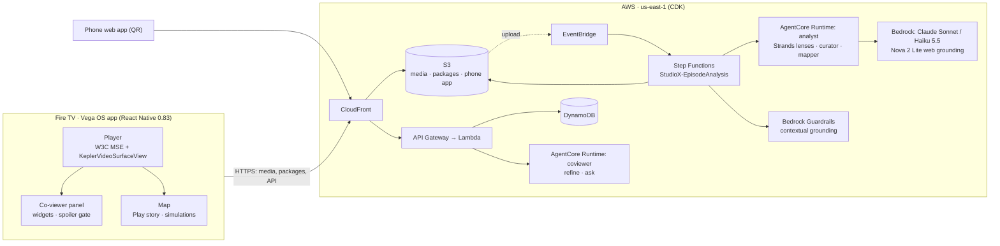

# StudioX: an AI co-viewer for video podcasts on Fire TV (Vega OS)

**Pause the episode and StudioX explains what you just heard.** You get fact checks with sources,
dossiers on the people named, timelines, routines, and a playable map of the whole conversation.
Every card is tied to the moment in the episode and never spoils what comes next. The Fire TV
remote is the only controller you need.

StudioX is a native **React Native for Vega** app (Vega OS, RN 0.83, Hermes). Its brain is an
agent pipeline on **AWS**: Step Functions, Strands Agents on Amazon Bedrock AgentCore, and Bedrock
Guardrails. The pipeline watches each episode once and publishes a validated package that the TV
draws natively.

> **Hackathon:** Build, Ship, Shape: Amazon Developer Hackathon · **Fire TV track (Vega OS)** ·
> **AWS Builder Mini Challenge** · with a **friction log of 46 entries**.


## For judges: the two-minute tour

| You want to check | Go to |
| --- | --- |
| **Friction log (bonus)**: 46 entries + 14 feature requests, each with task, steps, expected vs. actual, severity, workaround, suggestion | **[FRICTION_LOG.md](FRICTION_LOG.md)** |
| **AWS Builder Mini Challenge**: services, what each does, file paths, LIVE vs. BUILT, measured results | **[docs/aws-builder.md](docs/aws-builder.md)** |
| **How to run and test it**: tests, Vega Virtual Device build, remote walkthrough | **[TESTING.md](TESTING.md)** |
| Vega platform features used, with file paths | [Built on Vega](#built-on-vega-os) |
| How the project maps to each judging criterion | [Judging criteria](#how-studiox-maps-to-the-judging-criteria) |
| Architecture and the agent → TV contract | [docs/ARCHITECTURE.md](docs/ARCHITECTURE.md), [backend/CONTRACTS.md](backend/CONTRACTS.md) |
| Demo video | Linked on the Devpost project page |

## What it does

- **Pause to understand.** The co-viewer opens on the player's own `pause` event. It works the
  same from the remote's Play/Pause button, from Vega Media Controls, or from the SeekBar.
- **Cards, not chat.** Claims get a verdict (SUPPORTED / NUANCED / DEBUNKED / UNVERIFIED) with
  HTTPS sources. People get a dossier with a licensed portrait and its credit. Lists of names,
  routines and timelines each have their own TV-sized widget.
- **No spoilers, enforced in code.** Agents can read the transcript only up to the viewer's
  playhead. The TV adds a spoiler gate of its own.
- **The Map.** The conversation as one picture: a flow, a timeline, a comparison or a cluster.
  It has *Play story*, a step-through, and playable simulations, such as a night of 90-minute
  sleep cycles or compound growth.
- **Phone optional.** A QR code links a phone web app (on CloudFront) for uploads and sharing.
  The remote alone does everything else.

| | |
| --- | --- |
|  |  |
|  |  |

All screenshots are from the Vega Virtual Device (SDK 0.24.12112).

## How StudioX maps to the judging criteria

| Criterion (25% each) | What StudioX does | Evidence |
| --- | --- | --- |
| **Technical implementation** | Native Vega app using W3C MSE in React Native, `KeplerVideoSurfaceView`, Vega Media Controls, the Vega SeekBar and component lifecycle. On AWS: a CDK-defined Step Functions pipeline of Strands agents on AgentCore, with Guardrails grounding and rule-based verdicts. 203 Jest tests, 137 Python tests, evals with 0 false DEBUNKED verdicts and 0 spoiler leaks | [Built on Vega](#built-on-vega-os), [docs/aws-builder.md](docs/aws-builder.md), [`test/`](test), [`backend/eval/results.md`](backend/eval/results.md) |
| **Design** | A 10-foot UI on Vega's 960 × 540 dp canvas. Every element is reachable by D-pad, with a visible focus ring, deterministic first focus, focus restored on return, and a full BACK chain. Genre-themed Map scenes | [docs/product/design-language.md](docs/product/design-language.md), [docs/product/tv-ui-guidelines.md](docs/product/tv-ui-guidelines.md), [`src/components/FocusFrame.tsx`](src/components/FocusFrame.tsx) |
| **Potential impact** | On a TV, you can't look something up without leaving the show. StudioX makes long-form talk (health advice, true crime, money, history) understandable and checkable in place, and keeps the viewer watching instead of reaching for a phone. The same pipeline works on any uploaded episode | [docs/product/studiox-product-brief.md](docs/product/studiox-product-brief.md) |
| **Quality of the idea** | Not a video player with a chatbot. An AI co-viewer that adapts its cards and its Map to the episode's genre, is spoiler-safe by design, and is driven by the remote | [docs/product/coviewer-plan.md](docs/product/coviewer-plan.md) |
| **Bonus: friction log** | 46 entries (2 Critical, 20 Major, 24 Minor) across the Vega SDK, CLI, Virtual Device, Vega APIs, the Builder Tools MCP and AWS, with exact errors and a suggestion for each. Top five asks are summarised at the top | **[FRICTION_LOG.md](FRICTION_LOG.md)** |
| **AWS Builder Mini Challenge** | 11 AWS services plus the Strands Agents SDK, live in us-east-1, all defined in CDK. Amazon Transcribe and an ffmpeg Lambda are built but not yet deployed. Each one has a stated job, a file path and a status. Results are measured: 0 false DEBUNKED, 0 spoiler leaks, guardrail grounding 0.73–1.00 | **[docs/aws-builder.md](docs/aws-builder.md)** |

## Built on Vega OS

These primitives are specific to Vega. They are not part of stock React Native.

| Vega primitive | Where | What it gives StudioX |
| --- | --- | --- |
| **W3C Media Source Extensions** in React Native (`@amazon-devices/react-native-w3cmedia`): `MediaSource`, `SourceBuffer`, `srcObject` | [`src/player/mseLoader.ts`](src/player/mseLoader.ts) | Fragmented MP4 streamed in 2 MB range requests straight into Vega's media pipeline. This works on the Virtual Device, where URL mode failed (friction log F-45) |
| **`KeplerVideoSurfaceView`** + `setSurfaceHandle` | [`src/screens/Player.tsx`](src/screens/Player.tsx), [`src/player/useVideoPlayer.ts`](src/player/useVideoPlayer.ts) | Video is decoded on a platform surface. The AI panel, captions and SeekBar are ordinary RN views above it, and no frame passes through JavaScript |
| **Vega Media Controls**: `setMediaControlFocus()` before `initialize()`, plus the `IMediaPlaybackServer` manifest interface | `useVideoPlayer.ts`, [`manifest.toml`](manifest.toml) | The remote's transport keys reach the player, and pausing is the gesture that opens the co-viewer |
| **Vega UI Components `SeekBar`** (`@amazon-devices/kepler-ui-components`) | `Player.tsx` | AI chapter markers, a progress colour per segment, and a preview above the thumb, on Amazon's TV scrubber |
| **`useKeplerAppStateManager`** (per-component lifecycle) | `useVideoPlayer.ts`, [`src/hooks/usePairingSession.ts`](src/hooks/usePairingSession.ts) | On background, the player is paused and fully deinitialised and polling stops. On foreground, playback resumes from the saved position |
| **System toast** (`useToastKepler`, `com.amazon.notification.privilege.post`) | [`src/hooks/useSystemToast.ts`](src/hooks/useSystemToast.ts) | A native Fire TV toast when the phone sends something |
| **OS-provided Reanimated 4, SVG and w3cmedia** (split bundle) | [`package.json`](package.json) | The release `.vpkg` is **under 1 MB** (947 KB) with four native libraries. Panel and Map animations run on the UI thread |
| **`TVFocusGuideView`** (destinations, focus traps, `autoFocus`) and **`useTVEventHandler`** | [`src/components/NavRail.tsx`](src/components/NavRail.tsx), [`src/player/SpoilerGate.tsx`](src/player/SpoilerGate.tsx), [`src/map/MapScreen.tsx`](src/map/MapScreen.tsx) | D-pad focus that never gets lost, modals that trap focus, and remembered row position |

Built and debugged with the **Amazon Devices Builder Tools MCP**. Its media workflow set our player
initialisation order. Its gaps are documented in friction log section C.

## Architecture



The contract between the agents and the TV is the **episode package**, defined in
[`backend/CONTRACTS.md`](backend/CONTRACTS.md). Both sides validate it:
[`src/analysis/schema.ts`](src/analysis/schema.ts) on the TV and
[`backend/shared/python/studiox_core/schema.py`](backend/shared/python/studiox_core/schema.py) in
the pipeline. A card the agents can emit is exactly a card the TV can draw.

## Quick start

Full instructions: **[TESTING.md](TESTING.md)**. Setup details:
[docs/development/getting-started.md](docs/development/getting-started.md).

```bash
source ~/vega/env          # load the Vega CLI (after installing the Vega SDK)
npm install
npm test                   # Jest
npm run build:debug        # -> build/x86_64-debug/studiox_x86_64.vpkg
npm run vvd:start          # start the Vega Virtual Device
npm run run:vvd            # install and launch StudioX
```

Virtual Device keys: arrows move focus, Enter selects, Esc is Back, F4 is Play/Pause.

| Command | Purpose |
| --- | --- |
| `npm run build:debug` / `build:release` | Build the `.vpkg` packages (x86_64, aarch64, armv7) |
| `npm run vvd:start` / `vvd:stop` | Start or stop the Vega Virtual Device |
| `npm run run:vvd` | Install and launch the debug build on the Virtual Device |
| `npm run rebuild` | Memory-safe: stop the emulator, build, restart, relaunch |
| `npm test` / `typecheck` / `lint` | Jest, `tsc --noEmit`, ESLint |

## Repository layout

```
.
├── src/                      Vega OS app (React Native for Vega)
│   ├── screens/              Intro, Browse (Watch / Shared / Link), Player
│   ├── player/               W3C MSE loader, VideoPlayer lifecycle, co-viewer panel, spoiler gate
│   ├── widgets/              One renderer per card type (claim, dossier, timeline, routine, ...)
│   ├── map/                  The Map: layouts, scenes, Play story, night and growth simulations
│   ├── analysis/             Package schema + validation, bundled demo packages
│   ├── components/ hooks/ services/   Focus frame, nav rail, pairing, API client
│   └── theme.ts              Design tokens on the 960 × 540 dp canvas
├── test/                     Jest tests, mirroring src/
├── backend/
│   ├── infra/                AWS CDK app: StudioXCore + StudioXPipeline
│   ├── agents/               Strands agents on AgentCore (analyst, coviewer), local runner, tests
│   ├── functions/            Lambda: API and pipeline steps (Python 3.13)
│   ├── shared/               studiox_core: schema, verdict rules, map rules (shared by Lambda and agents)
│   ├── eval/                 Claim and spoiler evaluations, results.md
│   └── CONTRACTS.md          The agent → TV contract
├── webapp/link/              Phone web app (PWA), served from CloudFront
├── companion/                Local pairing and media server for development
├── docs/                     Architecture, product and design notes, setup guide, images
├── scripts/                  SDK install helper, memory-safe rebuild, intro render scripts
├── manifest.toml             Vega app manifest
├── FRICTION_LOG.md           Friction log and feature requests
└── TESTING.md                How to run and test
```

## Status and limits

- Runs on the **Vega Virtual Device** (x86_64). Release packages are built for aarch64 and armv7 as
  well. **No physical Fire TV has been tested**, so memory and performance on hardware are not
  measured.
- The AWS pipeline is deployed. Both demo episodes were analysed by it. The Map author, Amazon
  Transcribe and playable-upload steps are built and tested, but not yet deployed (see
  [docs/aws-builder.md](docs/aws-builder.md)).
- Demo episodes are short scripted clips: stock interview footage with dialogue written for the
  demo. The *More maps* examples are transcripts written by StudioX. All of them are labelled as
  such in the app.
- "Alexa, pause" through Vega Media Controls is untested, because the Virtual Device has no voice.

## Hackathon compliance

| Requirement | How it is met |
| --- | --- |
| New project in the submission period (after 31 Aug 2026) | First commit 20 Oct 2026 (`git log --reverse`) |
| Runs on Fire OS or Vega OS | Vega OS app, shown on the Vega Virtual Device |
| Open-source licence, detectable by GitHub | [MIT](LICENSE) |
| Setup and run instructions | [TESTING.md](TESTING.md), [getting-started.md](docs/development/getting-started.md) |
| AWS services with documented integrations | [docs/aws-builder.md](docs/aws-builder.md) |
| Friction log: task, steps, expected vs. actual, severity, workaround, suggestion | [FRICTION_LOG.md](FRICTION_LOG.md) |
| No secrets in the repo | Credentials, local config (`src/config.local.ts`), AgentCore state and private notes are git-ignored. The TV app holds no model keys |
| Third-party content | Images are public domain or CC BY-SA, with credits in the app and in [CREDITS.md](CREDITS.md) |

## Working with AI agents

StudioX was built with AI coding agents and the Amazon Devices Builder Tools MCP.
[AGENTS.md](AGENTS.md) and [CLAUDE.md](CLAUDE.md) are the instructions those agents follow.

## License

MIT. See [LICENSE](LICENSE). Third-party images and footage: [CREDITS.md](CREDITS.md).
