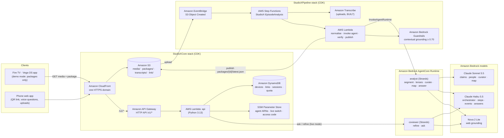
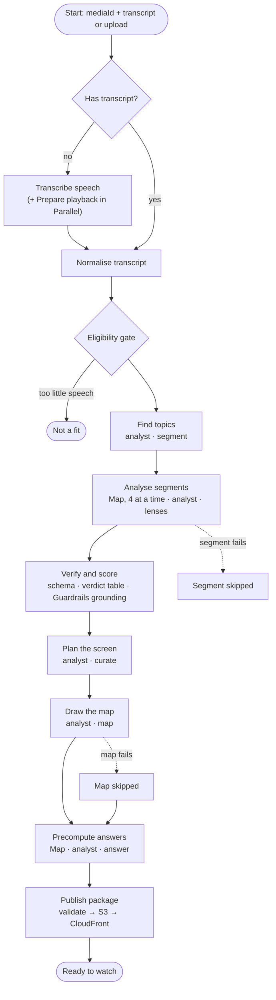

# AWS Builder Mini Challenge: how StudioX uses AWS

**In one line:** the Fire TV app never runs a model. An agent pipeline on AWS watches each episode
once, then publishes a small, validated **episode package**. The TV draws that package natively.

Everything is defined in one **AWS CDK (TypeScript)** app with two stacks, `StudioXCore` and
`StudioXPipeline`, deployed in us-east-1. The agents run on **Amazon Bedrock AgentCore Runtime**
and are built with the **Strands Agents SDK**.

Status key: **LIVE** = deployed and exercised in our account. **BUILT** = code and tests in this
repo, run locally against real Bedrock, not yet deployed.

## AWS architecture



## The pipeline: `StudioX-EpisodeAnalysis` (Step Functions, Standard)



Both demo episodes ran through this machine in the cloud and **SUCCEEDED** (about 2 minutes, in
parallel). A failed segment, map or answer becomes a skipped lane; it never fails the episode. The
state machine is in [`backend/infra/lib/pipeline-stack.ts`](../backend/infra/lib/pipeline-stack.ts).

## Services and what each one does

| Service | What it does in StudioX | Code | Status |
| --- | --- | --- | --- |
| **AWS Step Functions** (Standard) | `StudioX-EpisodeAnalysis`: has transcript? → normalise → eligibility gate → find topics → analyse segments (Map, 4 at a time) → verify and score → plan the screen → draw the map → precompute answers (Map) → publish. A failed segment or answer becomes a skipped lane; it does not fail the episode | [`backend/infra/lib/pipeline-stack.ts`](../backend/infra/lib/pipeline-stack.ts) | LIVE (both demo episodes SUCCEEDED, about 2 min in parallel). `Draw the map` BUILT |
| **Amazon Bedrock AgentCore Runtime** | Two Strands runtimes. `analyst` has the modes `segment`, `lenses`, `curate`, `map` and `answer`. `coviewer` has `refine` and `ask`. Both deployed with `agentcore deploy` | [`backend/agents/`](../backend/agents/README.md), [`agentcore.json`](../backend/agents/agentcore/agentcore.json) | LIVE |
| **Strands Agents SDK** | An orchestrator calls five lens agents as tools (claims, people, name lists, steps, timeline events). Every card uses Pydantic structured output. Hooks enforce product rules in code, not prompts: **SpoilerGuard** clamps transcript tool calls to the viewer's playhead, **BudgetGuard** caps tool calls, and **CitationGuard** keeps only URLs that a search in the same run returned | [`sxagents/lenses.py`](../backend/agents/sxagents/lenses.py), [`guards.py`](../backend/agents/sxagents/guards.py), [`analyst.py`](../backend/agents/sxagents/analyst.py), [`coviewer.py`](../backend/agents/sxagents/coviewer.py) | LIVE |
| **Amazon Bedrock models** | Claude Sonnet 5.5 for claims, people, curation and the map. Claude Haiku 5.5 for the orchestrator, steps, events and answers. Each model is chosen per job. Bedrock prompt caching: 17,428 cache-read tokens measured on one run | [`sxagents/llm.py`](../backend/agents/sxagents/llm.py) | LIVE |
| **Amazon Nova 2 Lite web grounding** | Fact-check search (`nova_grounding` system tool). It returns sources, and a deterministic table (`decide_verdict`) turns them into a verdict, not the model | [`sxagents/search.py`](../backend/agents/sxagents/search.py), [`studiox_core/verdict.py`](../backend/shared/python/studiox_core/verdict.py) | LIVE |
| **Amazon Bedrock Guardrails** | Contextual grounding (threshold 0.70) on each card's episode-sourced text, in `Verify and score`. The 9 demo cards scored 0.73–1.00 against the deployed guardrail. A prompt-attack screen covers viewer questions | [`functions/pipeline/verify.py`](../backend/functions/pipeline/verify.py), `pipeline-stack.ts` | LIVE |
| **AWS Lambda** (Python 3.13) | The API, plus the pipeline functions: normalise, invoke agent, verify, publish, set status, start pipeline | [`backend/functions/`](../backend/functions) | LIVE |
| **Amazon API Gateway** (HTTP API) | `/v1/*` for device registration, phone pairing, links, sessions, refine, ask and media | [`functions/api/`](../backend/functions/api) | LIVE |
| **Amazon DynamoDB** | One table: devices, links, sessions, messages, media, daily quota (with TTL) | `core-stack.ts` | LIVE |
| **Amazon S3 + Amazon CloudFront** | One HTTPS domain for media (fragmented MP4 for the TV's MSE player), episode packages and the phone web app, with Origin Access Control | [`backend/infra/lib/core-stack.ts`](../backend/infra/lib/core-stack.ts) | LIVE |
| **Amazon EventBridge** | A phone upload landing in S3 starts an analysis | `pipeline-stack.ts` | LIVE |
| **AWS Systems Manager Parameter Store** | Agent ARNs, guardrail ID, the live switch and the access code | `core-stack.ts`, `pipeline-stack.ts` | LIVE |
| **Amazon Transcribe** | Speech to timed text for phone uploads (the `Has transcript?` branch). The demo episodes supply their transcripts | `pipeline-stack.ts` | BUILT |
| **Lambda + ffmpeg layer** | `Prepare playback`: an upload is made playable on Vega (fragmented MP4), in a Parallel branch beside Transcribe | [`functions/pipeline/prepare_playback.py`](../backend/functions/pipeline/prepare_playback.py) | BUILT |

## Strands Agents primitives used

| Strands primitive | How StudioX uses it | Code |
| --- | --- | --- |
| **`Agent` + `BedrockModel`** | Every lens, the curator, the mapper and the co-viewer is a Strands `Agent` on a Bedrock model, with an explicit region | [`sxagents/llm.py`](../backend/agents/sxagents/llm.py) |
| **Agents as tools** | An orchestrator agent (Haiku) calls five lens agents, each wrapped as a `@tool`: `people_lens`, `claims_lens`, `burst_lens`, `protocol_lens`, `events_lens`. It runs only the lenses a segment needs | [`sxagents/lenses.py`](../backend/agents/sxagents/lenses.py) (`run_segment_lenses`) |
| **Concurrent tool execution** | Lens tools run in parallel within one orchestrator turn. Per-lens counters keep ids stable | `lenses.py` |
| **Structured output** (`structured_output_model`, Pydantic) | Every card, plan, map and answer is parsed into a Pydantic model and is never free text. The TV-side schema then validates the package again | `llm.py` (`structured`), [`sxagents/mapper.py`](../backend/agents/sxagents/mapper.py) |
| **`@tool` functions** | `read_transcript` (clamped to the playhead), `web_search`, `wikipedia_lookup` | [`sxagents/coviewer.py`](../backend/agents/sxagents/coviewer.py), `lenses.py` |
| **Hooks** (`HookProvider`, `BeforeToolCallEvent`) | **SpoilerGuard** rewrites transcript tool calls so they never read past the viewer's playhead. **BudgetGuard** sets `cancel_tool` once a tool or agent call budget is used up | [`sxagents/guards.py`](../backend/agents/sxagents/guards.py) |
| **CitationGuard** (our ledger on top of Strands tools) | A source URL is kept only if a search in the same invocation returned it | `guards.py` (`cite_guard`) |
| **Prompt caching** (`cachePoint` system block) | The shared transcript and brief are cached across tool loops: 17,428 cache-read tokens measured on one science run | `llm.py` |
| **Agent metrics** (`result.metrics.accumulated_usage`) | Tokens in and out and model calls per run feed our cost and latency tables | `llm.py`, [`backend/data/runs/`](../backend/data/runs) |
| **Record / replay** around Strands calls | `SX_RECORD` / `SX_REPLAY` record every model, search and wiki call to JSONL, so the agent tests run offline and deterministically | `llm.py`, [`backend/agents/tests/`](../backend/agents/tests) |

## Amazon Bedrock AgentCore primitives used

| AgentCore primitive | How StudioX uses it | Status |
| --- | --- | --- |
| **AgentCore Runtime** (`BedrockAgentCoreApp`, `@app.entrypoint`) | Two runtimes, `analyst` and `coviewer`, packaged as CodeZip, Python 3.13 | LIVE · [`app/analyst/main.py`](../backend/agents/app/analyst/main.py), [`app/coviewer/main.py`](../backend/agents/app/coviewer/main.py) |
| **AgentCore CLI** (`agentcore deploy`, `status`, `invoke`) | Project generated with `agentcore create`, deployed with `agentcore deploy` | LIVE · [`backend/agents/agentcore/agentcore.json`](../backend/agents/agentcore/agentcore.json) |
| **Observability** (Transaction Search) | Transaction Search enabled by `agentcore deploy`. Agent traces of each run can be viewed in CloudWatch | LIVE |
| **Invoke from Step Functions / Lambda** | `invoke_agent` Lambda calls `InvokeAgentRuntime` with the ARN from SSM | LIVE · [`functions/pipeline/invoke_agent.py`](../backend/functions/pipeline/invoke_agent.py) |
| **Gateway Web Search Tool** (`WebSearchClient`, MCP over SigV4) | Wired in code as the preferred search when `GATEWAY_URL` is set, with a fallback to Nova grounding | BUILT (not enabled) · [`sxagents/search.py`](../backend/agents/sxagents/search.py) |
| **AgentCore Memory** (`MemoryClient.create_event`) | Writes the co-viewer's ask turns when `MEMORY_ID` is set | BUILT (not enabled) · `coviewer.py` |

## Design decisions worth a look

- **The model suggests; code decides.** Verdict labels come from a rule table. Map nodes are snapped
  to the transcript line they come from. Simulation parameters are clamped, and a question whose
  precomputed answer failed is dropped
  ([`studiox_core/map.py`](../backend/shared/python/studiox_core/map.py)).
- **Ground the episode's words, cite the world's.** Guardrails grounding is applied only to what a
  card says the episode said. Outside facts are covered by CitationGuard instead. This fixed a run
  where good cards scored 0.02–0.49 because web context was being grounded against the transcript.
- **No spoilers, enforced in code.** SpoilerGuard is a Strands hook. It cuts transcript reads at
  the viewer's playhead before the model sees them.
- **Bounded cost.** Live routes are off by default (`/studiox/live`). They sit behind an access
  code, a daily quota, a daily upload cap and a 1 GiB upload limit. The TV's default build is a
  demo build that makes no live AI calls.
- **One contract.** [`backend/CONTRACTS.md`](../backend/CONTRACTS.md) defines the package.
  [`src/analysis/schema.ts`](../src/analysis/schema.ts) on the TV and
  [`studiox_core/schema.py`](../backend/shared/python/studiox_core/schema.py) in the pipeline both
  validate it.

## Measured results

From [`backend/eval/results.md`](../backend/eval/results.md) (3 runs per case, 22 Oct 2026):

| Metric | Result |
| --- | --- |
| False DEBUNKED verdicts across 39 claim checks | **0** |
| Spoiler leaks across 39 mid-episode questions | **0** |
| Source URLs that are HTTPS | **21 / 21** |
| Verdict agreement on surfaced claims | 13 / 15 |
| Median package time | 91 s |

Local runs of the full package, with real Bedrock on 23 Oct (from `backend/data/runs/*.run.json`):

| Package | Model calls | Tokens in / out | Wall time | Funnel (candidates → kept → shown) |
| --- | --- | --- | --- | --- |
| science-ep42 | 23 | 20,456 / 16,627 | 128.9 s | 14 → 7 → 7 |
| crime-case104 | 14 | 8,808 / 9,354 | 94.8 s | 9 → 2 → 2 |
| cameo-finance | 23 | 19,802 / 19,729 | 191.9 s | 7 → 4 → 4 |
| cameo-tech | 19 | 15,306 / 10,669 | 211.0 s | 6 → 5 → 5 |
| cameo-history | 21 | 18,064 / 14,466 | 110.5 s | 12 → 8 → 6 |

## AWS friction we logged

Nine AWS entries are in the [friction log, section D](../FRICTION_LOG.md#aws). Examples: Nova
grounding citations have no page title (F-52), grounded verdicts change between identical runs
(F-62), commercial wellness pages behind a strong verdict (F-54), and Claude 5.5 rejecting
`temperature` (F-50).

## Run it on AWS

Prerequisites: Node 22, Python 3.13 with [`uv`](https://docs.astral.sh/uv/), the AWS CLI, the
AgentCore CLI, and Bedrock model access to Claude Sonnet 5.5, Claude Haiku 5.5 and Nova 2 Lite in
us-east-1. Full details are in [`backend/README.md`](../backend/README.md) and
[`backend/agents/README.md`](../backend/agents/README.md).

**1. Test offline (no AWS calls)**

```bash
uv run --python 3.13 --with pytest pytest backend/shared/tests -q
uv run --python 3.13 --with pytest pytest backend/functions/pipeline/tests -q
(cd backend/functions/api && uv run --python 3.13 --with pytest pytest -q)
uv run --python 3.13 --with pytest --with strands-agents --with bedrock-agentcore pytest backend/agents/tests -q
(cd backend/infra && npm install && npx cdk synth -q)
```

**2. Run the agents locally against Bedrock (no deploy; Bedrock access only)**

```bash
# A full episode package: segment → lenses → verify → curate → map → answers
uv run --python 3.13 backend/agents/run_local.py package \
  --transcript backend/data/transcripts/science-ep42.json --out /tmp/science-ep42.json --media-id science-ep42
# The co-viewer: a spoiler-safe answer at t = 12 s
uv run --python 3.13 backend/agents/run_local.py ask \
  --transcript backend/data/transcripts/science-ep42.json --t 12 --question "Is the 37% from a real study?"
# Claim and spoiler evaluations, 3 runs per case -> backend/eval/results.md
uv run --python 3.13 backend/eval/run_eval.py --runs 3
```

**3. Deploy (your own account; a profile that can deploy)**

```bash
./backend/scripts/fetch_ffmpeg.sh                      # optional: ffmpeg layer for playable uploads
cd backend/infra && npm install
AWS_PROFILE=<profile> npx cdk deploy StudioXCore        # S3, CloudFront, API, DynamoDB, SSM
AWS_PROFILE=<profile> npx cdk deploy StudioXPipeline    # Step Functions, Lambdas, Guardrail

cd ../agents                                           # AgentCore project root
cp agentcore/aws-targets.example.json agentcore/aws-targets.json   # set your account ID
(cd agentcore/cdk && npm install)
agentcore deploy                                       # both Strands runtimes
agentcore status                                       # prints the runtime ARNs
aws ssm put-parameter --overwrite --type String --name /studiox/agents/analyst/arn  --value <analyst ARN>
aws ssm put-parameter --overwrite --type String --name /studiox/agents/coviewer/arn --value <coviewer ARN>
```

**4. Analyse an episode in the cloud**

```bash
python3 backend/scripts/seed_demo.py cloud science-ep42 crime-case104   # upload transcripts, run, pull packages
# or by hand:
ARN=$(aws cloudformation describe-stacks --stack-name StudioXPipeline \
  --query "Stacks[0].Outputs[?OutputKey=='StateMachineArn'].OutputValue" --output text)
aws stepfunctions start-execution --state-machine-arn "$ARN" \
  --input '{"mediaId":"science-ep42","transcriptKey":"transcripts/science-ep42.json","title":"Elite Recovery Protocols"}'
```

**5. Try the live co-viewer and the API**

```bash
agentcore invoke --runtime coviewer \
  '{"action":"ask","sessionId":"s-0123456789abcdef0123456789abcdef0","mediaId":"science-ep42","t":12,"question":"Is the 37% real?"}'
DOMAIN=<your CloudFront domain> ./backend/scripts/smoke.sh   # register → pair → redeem → link, end to end
# Live routes start off; turn them on for your own build:
aws ssm put-parameter --overwrite --type String --name /studiox/access-code --value <code>
aws ssm put-parameter --overwrite --type String --name /studiox/live --value on
```

**Tear down:** `AWS_PROFILE=<profile> npx cdk destroy StudioXPipeline StudioXCore` in `backend/infra`. Then remove the
runtimes with the AgentCore CLI.

AWS friction we hit along the way is in [friction log section D](../FRICTION_LOG.md#aws).
